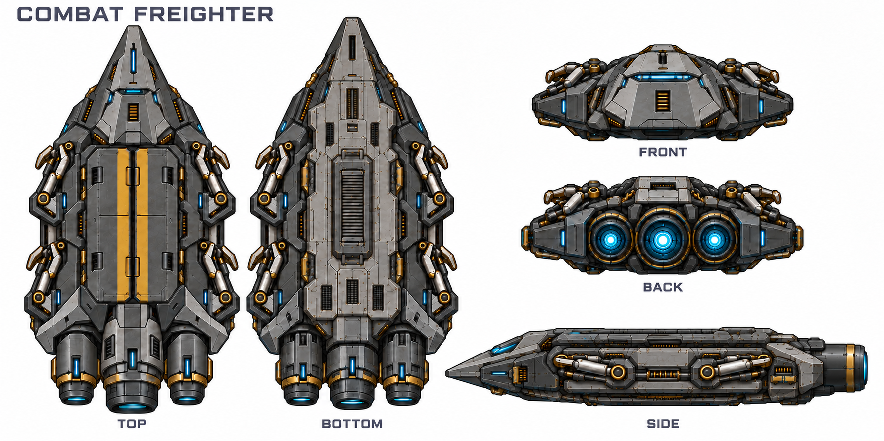

# Combat Freighter reference art

[Transparent hull sprite](combat-freighter.png) · [Five-view reference](combat-freighter-reference.png)

An unarmed corporate raiding freighter: wedge bow, narrow bridge slit, one
armored cargo citadel with two long doors and a broad amber stripe, four folded
three-fingered grapple arms, and three level engines with a larger center drive.

The sprite is 1254 × 1254 RGBA with genuine transparent margins; its visible
length fills 94.34% of the canvas and its width/length ratio is 0.53. The
1774 × 887 white sheet contains TOP, BOTTOM, FRONT, BACK and SIDE. Its side
view was corrected so the three engines overlap in profile at one height.

Generated with **built-in image_gen**, using the existing Interceptor only
for fleet finish and the Construction Ship sheet only for presentation.
The selected PNGs are copied unchanged from the generated originals.

- [User brief](art-brief.txt)
- [Exact initial prompts](prompts.json)
- [Sprite correction and selected output paths](generation.json)
- [Exact reference-sheet correction prompts](reference-corrections.json)
- [Alpha/framing measurements](sprite-validation.json)
- [Textured model and integration notes](../ship-models/combat-freighter-textured-v1/README.md)

