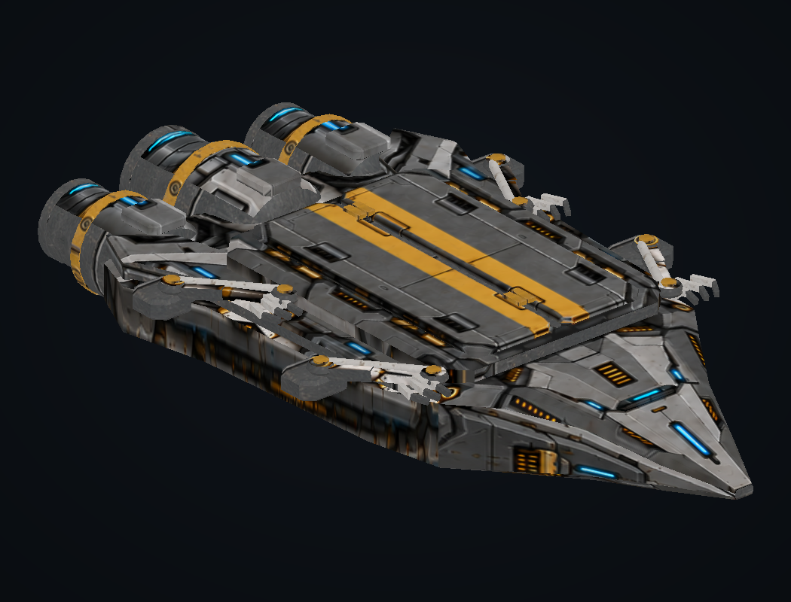

# Combat Freighter

[GLB](combat-freighter.glb) · [OBJ](combat-freighter.obj) · [Interactive viewer](viewer.html) · [Model metadata](model-info.json) · [Five-view source](textures/reference-sheet.png)

5,746 triangles, 101 closed source components, two render sections. One armored
cargo citadel, two separate hold doors, four folded three-fingered grapple arms,
and three level engines. Y up, −Z forward; width/length 0.530. No weapons.

Three embedded 2048px maps supply base color, metallic/roughness and cyan-only
emission. The amber door stripe is non-emissive paint. Native top/bottom
reference projections cover the hull and dedicated ventral loading hatch.
Registered side plating, physical-density metal trim charts, and radial nozzle
charts cover the remaining faces. Invalid or collapsed UV charts fail the build.
The illustration's view proportions are registered to the common mesh; the three
engine axes share one height even where a drawing differs slightly.



[All eight views](previews/contact-sheet.png) · [Underside](previews/underside.png) · [Unlit texture inspection](previews/three-quarter-unlit.png)

## Production integration

The shared LOD pipeline exports **5,746 / 5,100 / 4,630 triangles** for LOD0/1/2.
LOD2 ships in `client/public/art/derived/ship-models/v1/combat-freighter-lod2.glb`.
All hull, door, armor, claw, underside, engine collar, nozzle rim and exhaust
triangles are protected. Other rounded machinery loses tessellation. Original
texture bytes, materials and sockets are preserved in every LOD.

Socket names are `socket.engine.port`, `socket.engine.centre` and
`socket.engine.starboard`, all facing +Z. There are no weapon sockets. The
generated hardpoint table produces three distinct engine plumes.

The game catalog, map loader and panel icons use the dedicated hull. The bake
produces top/perspective/bottom masters in `../game-ready-v1/`, five map sizes,
two panel sizes and a perspective fallback. The map/battle presentation keeps
its existing 2,000-mass sizing between Tiny and Small Freighters. The construction
yard also uses an intermediate display length. Gameplay rules are unchanged.

## Verification

- [Source geometry and feature checks](surface-verification.json): 5,746
  nondegenerate triangles; 101 closed components; exactly four claws, 12 fingers,
  two hold doors and three engines; all three sockets aligned.
- [Texture audit](verification/texture-audit.json): all components have finite,
  noncollapsed UVs; no surface exceeds 4× UV anisotropy or falls below 8
  texels/world-unit. Actual worst values are 3.147× and 13.664 texels/unit.
- [glTF validation](gltf-validation.json): source and all three LODs have zero
  errors and warnings.
- [LOD verification](../interceptor-lod-experiment-v1/combat-freighter-geometry-verification.json):
  protected surfaces, source texture bytes, materials, sockets, ventral mapping
  and bounds preserved; LOD0 preserves every source triangle and attribute.
- [Source hashes](source-integrity.json) and
  [existing production asset check](verification/existing-assets-verified.json).
- [Integration checks and final file hashes](verification/integration-verification.json).
- Browser captures: [map size comparison](verification/map-comparison.png),
  [production preview](verification/production-preview.png),
  [underside](verification/production-bottom.png),
  [three exhausts](verification/production-back.png).

See [ship model integration](../../../../docs/ship-model-integration.md) for
runtime behavior and the full regression workflow.

## Rebuild

Run from the repository root:

```sh
python3 client/art-src/ship-models/combat-freighter-textured-v1/build_model.py
python3 client/art-src/ship-models/combat-freighter-textured-v1/verify_model.py
node client/art-src/ship-models/combat-freighter-textured-v1/build_preview.mjs
node client/art-src/ship-models/interceptor-lod-experiment-v1/build_models.mjs combat-freighter
python3 client/art-src/ship-models/interceptor-lod-experiment-v1/verify_geometry.py combat-freighter
node client/art-src/ship-models/combat-freighter-textured-v1/verify_gltf.mjs
```

Then run `npm run assets:ships:bake` from `client`, open its printed local URL
and wait for completion. Run `npm run assets:hardpoints`, the integration tests,
and `npm run build`. The baker retains verified renders of unchanged ships.

Geometry uses the shared [mining pipeline](../mining-fleet-v1/README.md) and
physical UV helpers from the trader pipeline. No Blender step is required.
The two original raster masters, built-in ImageGen prompts and corrections
are in [the reference-art folder](../../combat-freighter-reference-v1/README.md).
