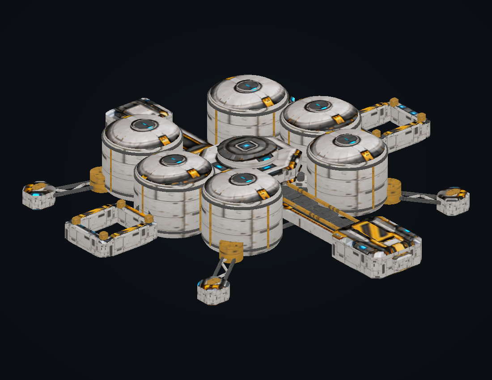

# Mining Belt Station

[GLB](mining-belt-station.glb) · [OBJ](mining-belt-station.obj) · [Model metadata and sockets](model-info.json) · [Five-view source](textures/reference-sheet.png)

14,536 triangles, two render sections, six vertical ore silos, an octagonal core, two open barge berths, one hauler gantry and four anchoring booms. Small station-keeping pods; no main engines. Y up, −Z forward. Both docking windows are geometric openings.

[Underside](previews/underside.png) · [Top](previews/top.png) · [Bottom](previews/bottom.png) · [Front](previews/front.png) · [Back](previews/back.png) · [Side](previews/side.png)

See the [shared pipeline notes](../mining-fleet-v1/README.md) for rebuilding, validation, scale conventions and attachment-point usage.
